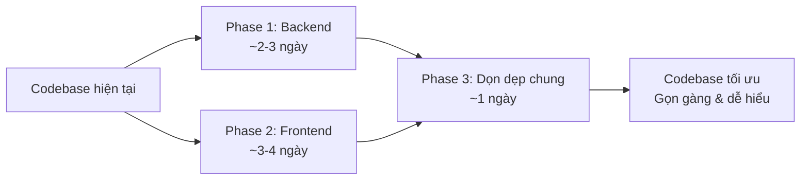
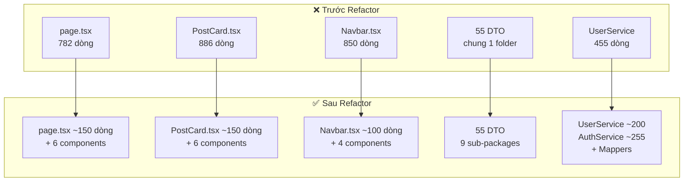

# 🔧 Plan Tối Ưu Hóa Codebase VnNet — Backend & Frontend

> **Mục tiêu**: Tái cấu trúc (refactor) code để gọn gàng hơn, dễ bảo trì, đúng quy trình thực tế — **không thay đổi chức năng, không ảnh hưởng hệ thống hiện tại**.

---

## Tổng Quan Hiện Trạng

| Phần | Tổng file code | File > 500 dòng | Vấn đề chính |
|------|:-:|:-:|---|
| **Backend Java** | ~140 file (.java) | 5 file | DTO rời rạc, thiếu mapper, config lộn xộn |
| **Frontend Next.js** | ~65 file (.tsx/.ts) | 7 file | Component khổng lồ (page.tsx 782 dòng, PostCard 886 dòng, Navbar 850 dòng), thiếu types, code lặp |



---

## User Review Required

> [!IMPORTANT]
> Plan này **chỉ refactor** — tách file, đổi tên, nhóm lại. **Không thêm/xóa chức năng**. Tất cả API endpoints, UI hiện tại đều giữ nguyên 100%.

> [!WARNING]
> Một số thay đổi (đặc biệt Phase 1.3 — DTO grouping và Phase 2.1 — tách component) sẽ thay đổi đường dẫn import. Cần test kỹ sau mỗi phase.

---

## Open Questions

> [!IMPORTANT]
> 1. Bạn muốn thực hiện từng phase một (an toàn hơn) hay làm tất cả cùng lúc?
> 2. Backend hiện có file `db/migration/V1__migrate_messages_to_conversations.sql` nhưng `ddl-auto: update` vẫn bật — bạn có muốn chuyển sang `validate` luôn không?
> 3. Frontend đang dùng cả `leaflet` lẫn `mapbox-gl` — bạn muốn giữ cả hai hay chỉ giữ một?

---

## Phase 1: Backend Java — Tổ Chức Lại (2-3 ngày)

### 1.1 Nhóm DTO theo feature (domain)

**Vấn đề**: Hiện tại **~55 DTO** nằm chung 1 thư mục `dto/`, rất khó tìm khi dự án lớn.

**Giải pháp**: Chia DTO thành sub-packages theo chức năng:

```
dto/
├── auth/           ← Xác thực
│   ├── UserCreateDto.java
│   ├── TokenDto.java
│   ├── ForgotPasswordDto.java
│   ├── ResetPasswordDto.java
│   ├── VerifyOtpDto.java
│   ├── ResendOtpDto.java
│   ├── ChangePasswordDto.java
│   ├── GoogleLoginDto.java
│   ├── GoogleRegisterDto.java
│   └── GoogleAuthResponseDto.java
├── user/           ← User profile
│   ├── UserResponseDto.java
│   ├── UserUpdateDto.java
│   └── ActivityDataDto.java
├── post/           ← Bài viết
│   ├── PostCreateDto.java
│   ├── PostUpdateDto.java
│   ├── PostResponseDto.java
│   ├── CommentCreateDto.java
│   ├── CommentResponseDto.java
│   ├── ReactionResponseDto.java
│   └── TrendingHashtagDto.java
├── social/         ← Bạn bè, nhóm
│   ├── FriendRequestResponseDto.java
│   ├── FriendshipResponseDto.java
│   ├── GroupDTO.java
│   ├── GroupMemberDTO.java
│   ├── CreateGroupRequest.java
│   ├── UpdateGroupRequest.java
│   └── UpdateGroupRoleRequest.java
├── chat/           ← Tin nhắn, hội thoại
│   ├── ChatMessageRequestDto.java
│   ├── ChatMessageResponseDto.java
│   ├── ConversationDto.java
│   ├── ConversationResponseDto.java
│   ├── ConversationMemberDto.java
│   ├── CreateDirectConversationDto.java
│   ├── CreateGroupConversationDto.java
│   ├── UpdateGroupDto.java
│   ├── AddMembersDto.java
│   ├── SetNicknameDto.java
│   ├── OnlineStatusDto.java
│   ├── ReadReceiptDto.java
│   ├── TypingEventDto.java
│   └── WebSocketMessageDto.java
├── game/           ← Trò chơi
│   ├── GameResponseDto.java
│   ├── GameScoreCreateDto.java
│   ├── GameScoreResponseDto.java
│   ├── GameStatsDto.java
│   ├── GameAchievementDto.java
│   └── LeaderboardEntryDto.java
├── event/          ← Sự kiện
│   ├── EventCreateDto.java
│   └── EventResponseDto.java
├── story/          ← Stories
│   ├── StoryCreateDto.java
│   ├── StoryResponseDto.java
│   └── StoryGroupDto.java
└── common/         ← Dùng chung
    ├── MessageDto.java
    ├── PagedResponseDto.java
    └── SearchResultDto.java
```

**Cách làm**: Chỉ di chuyển file + update import. Không sửa logic.

---

### 1.2 Tách config thành 2 nhóm rõ ràng

**Vấn đề**: Folder `config/` hiện chứa cả cấu hình app lẫn data seeder/migration, lẫn WebSocket handler — rất lộn xộn.

**Giải pháp**:

```
config/
├── CloudinaryConfig.java        ← Bean configs
├── CorsConfig.java
├── SecurityConfig.java
├── AsyncConfig.java
├── WebSocketConfig.java
├── GlobalExceptionHandler.java
└── WebSocketAuthInterceptor.java

websocket/                        ← Tách riêng WebSocket handlers
├── WebSocketEventListener.java

bootstrap/                        ← Khởi tạo dữ liệu & migration
├── GameDataSeeder.java
├── DatabaseSchemaFixer.java
└── DataMigrationRunner.java
```

**Lý do**: Trong dự án thực tế, `config` chỉ chứa cấu hình Spring Bean. Seeder/migration thuộc nhóm khác.

---

### 1.3 Dọn dẹp naming DTO trùng lặp

**Vấn đề**: Có những DTO gây nhầm lẫn:
- `UpdateGroupRequest` vs `UpdateGroupDto` — một cho Group (xã hội), một cho Conversation (chat) nhưng tên giống nhau
- `CreateGroupRequest` vs `CreateGroupConversationDto` — tương tự
- `GroupDTO` dùng viết hoa toàn bộ, không nhất quán với `GroupMemberDTO` vs `ConversationMemberDto`

**Giải pháp**: Đổi tên rõ ràng hơn:

| Tên cũ | Tên mới | Lý do |
|--------|---------|-------|
| `UpdateGroupRequest` | `UpdateSocialGroupDto` | Phân biệt với chat group |
| `CreateGroupRequest` | `CreateSocialGroupDto` | Nhất quán |
| `GroupDTO` | `SocialGroupDto` | Nhất quán naming (camelCase) |
| `GroupMemberDTO` | `SocialGroupMemberDto` | Nhất quán |
| `UpdateGroupDto` | `UpdateConversationGroupDto` | Rõ đây là cho chat |

---

### 1.4 Tách Service lớn

**Vấn đề**: Một số service quá lớn, chứa cả business logic lẫn DTO mapping:

| Service | Dòng code | Vấn đề |
|---------|:-:|---|
| `ConversationService.java` | 480 | Xử lý cả CRUD, members, messages, read receipts |
| `UserService.java` | 455 | Xử lý cả auth, profile, Google login, OTP |
| `PostService.java` | 344 | Xử lý cả CRUD, feed ranking, trending |
| `GameService.java` | 338 | Xử lý cả game CRUD, scores, achievements, leaderboard |

**Giải pháp**: Tách theo trách nhiệm (Single Responsibility):

#### `UserService.java` (455 dòng) → 2 file:
```
service/
├── UserService.java              ← Profile CRUD, search users (~200 dòng)
└── AuthService.java              ← Register, login, Google auth, OTP, reset password (~255 dòng)
```

#### `ConversationService.java` (480 dòng) — giữ nguyên nhưng extract mapping:
- Tách phần DTO mapping thành `ConversationMapper.java` trong folder `mapper/` mới
- Service chỉ còn business logic

#### `PostService.java` (344 dòng) — chấp nhận được, chỉ tách mapper
#### `GameService.java` (338 dòng) — chấp nhận được, chỉ tách mapper

**Tạo folder `mapper/`**:
```
mapper/
├── ConversationMapper.java    ← entity ↔ DTO conversion
├── PostMapper.java
├── UserMapper.java
├── GameMapper.java
└── StoryMapper.java
```

> [!TIP]
> Mapper giúp service gọn hơn **rất nhiều** và dễ test riêng. Nếu sau này muốn dùng MapStruct thì chỉ cần thay thế mapper thủ công bằng annotation.

---

### 1.5 Sửa anti-pattern `ddl-auto: update` + SQL migration

**Vấn đề**: `application.yaml` dùng `ddl-auto: update` nhưng cũng có thư mục `db/migration/` — hai cách quản lý schema cùng lúc là anti-pattern.

**Giải pháp**:
- **Development**: Giữ `ddl-auto: update` cho tiện
- **Production**: Đổi thành `ddl-auto: validate`
- Thêm Spring profile rõ ràng:

```yaml
# application.yaml (mặc định cho dev)
spring:
  jpa:
    hibernate:
      ddl-auto: update

---
# application-prod.yaml (production)
spring:
  jpa:
    hibernate:
      ddl-auto: validate
```

---

### 1.6 Thêm Controller mới thay vì dồn endpoint

**Vấn đề hiện tại**: `UserController` đang xử lý cả auth lẫn profile. `PostController` xử lý cả post CRUD, comments, likes.

**Giải pháp**: Nếu đã tách `AuthService`, nên tạo `AuthController`:

```
controller/
├── AuthController.java       ← [MỚI] /auth/login, /auth/register, /auth/google, /auth/forgot-password, /auth/reset-password
├── UserController.java       ← /users/me, /users/{id}, /users (chỉ profile)
├── ... (giữ nguyên các controller khác)
```

> [!IMPORTANT]
> Nếu frontend đang gọi `/users/login`, `/users/register` — cần thêm redirect hoặc giữ cả endpoint cũ tạm thời để **không break frontend**.

---

## Phase 2: Frontend Next.js — Tách Component & Tổ Chức (3-4 ngày)

### 2.1 Tách Component khổng lồ

Đây là phần **quan trọng nhất** của frontend. Nhiều file quá lớn, chứa toàn bộ logic + UI trong 1 file.

#### 2.1.1 Tách `page.tsx` (Home — 782 dòng) → 4-5 component

```
app/
└── page.tsx                          ← Giảm còn ~150 dòng (layout + state chính)

components/
├── home/                             ← [MỚI] Nhóm components trang chủ
│   ├── WelcomeBanner.tsx             ← Greeting card (~30 dòng)
│   ├── GroupCircleRow.tsx            ← Danh sách nhóm tham gia (~40 dòng)
│   ├── PostComposer.tsx             ← Form đăng bài (~200 dòng)
│   ├── FeedList.tsx                  ← Danh sách bài viết + infinite scroll (~80 dòng)
│   ├── FriendsSidebar.tsx           ← Sidebar bạn bè (~60 dòng)
│   └── TrendingSidebar.tsx          ← Sidebar xu hướng (~40 dòng)
```

**Trước (page.tsx)**:
```tsx
// 782 dòng — tất cả logic + UI dồn trong 1 file
export default function Home() {
  const [posts, setPosts] = useState([]);
  const [currentUser, setCurrentUser] = useState(null);
  const [suggestedUsers, setSuggestedUsers] = useState([]);
  // ... 20+ state variables
  // ... 10+ handler functions
  // ... 500+ dòng JSX
}
```

**Sau**:
```tsx
// ~150 dòng — chỉ orchestration
export default function Home() {
  const { currentUser, isLoading } = useAuthCheck();
  
  return (
    <div>
      <Navbar />
      <div className="max-w-7xl mx-auto flex gap-4">
        <Sidebar />
        <main>
          <WelcomeBanner username={currentUser?.username} />
          <GroupCircleRow />
          <PostComposer currentUser={currentUser} onPostCreated={refresh} />
          <FeedList />
        </main>
        <aside>
          <FriendsSidebar />
          <TrendingSidebar />
        </aside>
      </div>
    </div>
  );
}
```

#### 2.1.2 Tách `PostCard.tsx` (886 dòng) → 5 component

```
components/
├── post/                             ← [MỚI] Nhóm components bài viết
│   ├── PostCard.tsx                  ← Container chính (~150 dòng)
│   ├── PostHeader.tsx               ← Avatar, tên, thời gian, menu (...) (~80 dòng)
│   ├── PostContent.tsx              ← Nội dung, ảnh, shared post (~100 dòng)
│   ├── PostReactions.tsx            ← Like/reaction buttons + picker (~120 dòng)
│   ├── PostComments.tsx             ← Danh sách comments + form (~200 dòng)
│   ├── ShareModal.tsx               ← Modal chia sẻ (~50 dòng)
│   └── PostEditForm.tsx             ← Form chỉnh sửa (~60 dòng)
```

**Lý do**: PostCard hiện tại quản lý **25+ state variables** trong 1 component — vi phạm Single Responsibility nghiêm trọng.

#### 2.1.3 Tách `Navbar.tsx` (850 dòng) → 4 component

```
components/
├── navbar/                           ← [MỚI]
│   ├── Navbar.tsx                    ← Container + layout (~100 dòng)
│   ├── NavSearch.tsx                ← Thanh tìm kiếm (~80 dòng)
│   ├── NavLinks.tsx                 ← Navigation icons/links (~50 dòng)
│   ├── NavActions.tsx               ← Messages, notifications, profile dropdown (~150 dòng)
│   └── NotificationDropdown.tsx     ← Dropdown thông báo (~120 dòng)
```

#### 2.1.4 Tách `MapComponent.tsx` (1220 dòng!) → component con

```
components/
├── map/                              ← [MỚI]
│   ├── MapComponent.tsx             ← Container chính (~200 dòng)
│   ├── MapMarkerPopup.tsx          ← Popup khi click marker (~80 dòng)
│   ├── MapSearchBar.tsx            ← Thanh tìm kiếm bản đồ (~100 dòng)
│   ├── MapDirections.tsx           ← Chỉ đường (~150 dòng)
│   ├── MapSidebar.tsx              ← Sidebar thông tin (~150 dòng)
│   └── useMapState.ts              ← Custom hook cho map state (~200 dòng)
```

---

### 2.2 Tạo shared UI components (tái sử dụng)

**Vấn đề**: Nhiều UI pattern lặp đi lặp lại khắp nơi:

1. **Avatar component**: Code render avatar (có ảnh → ``, không có → div gradient + initials) lặp lại **ít nhất 15 lần** trong codebase
2. **Modal component**: 4+ modal trong `messages/` đều có cùng overlay + close button + animation
3. **Loading spinner**: Pattern `<div className="animate-spin rounded-full ...">` lặp lại nhiều nơi

**Giải pháp**: Tạo `components/ui/`:

```
components/
├── ui/                               ← [MỚI] Shared UI primitives
│   ├── Avatar.tsx                    ← Xử lý cả avatar có ảnh và fallback initials
│   ├── Modal.tsx                     ← Base modal với overlay, close, animation
│   ├── Spinner.tsx                   ← Loading spinner
│   ├── EmptyState.tsx               ← Trạng thái trống (icon + message)
│   └── ConfirmDialog.tsx            ← Confirm dialog thay thế window.confirm()
```

**Ví dụ Avatar component**:
```tsx
// components/ui/Avatar.tsx
interface AvatarProps {
  src?: string;
  name: string;
  size?: 'sm' | 'md' | 'lg';
  glow?: boolean;
}

export default function Avatar({ src, name, size = 'md', glow }: AvatarProps) {
  const sizes = { sm: 'w-7 h-7', md: 'w-10 h-10', lg: 'w-16 h-16' };
  
  if (src) {
    return ;
  }
  
  return (
    <div className={`${sizes[size]} bg-gradient-to-br from-indigo-500 to-indigo-600 rounded-full text-white flex items-center justify-center font-bold`}>
      {name?.charAt(0)?.toUpperCase() || 'U'}
    </div>
  );
}
```

> [!TIP]
> Component `Avatar` dùng được sẽ **giảm ~100+ dòng code lặp** xuyên suốt project.

---

### 2.3 Tạo custom hooks để tách logic khỏi UI

**Vấn đề**: Các page component trộn lẫn data fetching, state management, và UI rendering.

**Giải pháp**: Tạo `hooks/`:

```
hooks/                                ← [MỚI]
├── useAuth.ts                       ← Check auth, get current user, redirect if not logged in
├── usePosts.ts                      ← Fetch posts, pagination, infinite scroll
├── useFriends.ts                    ← Fetch friends, suggestions, send request
├── useNotifications.ts              ← Fetch & mark-read notifications
└── useInfiniteScroll.ts             ← Generic infinite scroll hook (tái sử dụng)
```

**Ví dụ `useAuth.ts`**:
```tsx
// hooks/useAuth.ts
export function useAuth() {
  const [currentUser, setCurrentUser] = useState(null);
  const [isLoading, setIsLoading] = useState(true);
  const router = useRouter();

  useEffect(() => {
    const token = getAuthToken();
    if (!token) { router.push('/login'); return; }
    
    api.get('/users/me')
      .then(res => setCurrentUser(res.data))
      .catch(() => { removeAuthToken(); router.push('/login'); })
      .finally(() => setIsLoading(false));
  }, []);

  return { currentUser, isLoading };
}
```

> **Tại sao quan trọng?**: Logic `useAuth` hiện đang **copy-paste** ở `page.tsx`, `friends/page.tsx`, `settings/page.tsx`, `profile/[id]/page.tsx`... Một hook dùng chung = sửa 1 chỗ thay vì 5+ chỗ.

---

### 2.4 Thêm TypeScript types thay vì `any`

**Vấn đề**: Rất nhiều `any` trong code:
```tsx
const [posts, setPosts] = useState<any[]>([]);      // ← any
const [currentUser, setCurrentUser] = useState<any>(null);  // ← any
```

**Giải pháp**: Mở rộng folder `types/` (hiện chỉ có `game.ts` và `messages.ts`):

```
types/
├── game.ts          ← ĐÃ CÓ ✅
├── messages.ts      ← ĐÃ CÓ ✅
├── user.ts          ← [MỚI] User, UserProfile, AuthResponse
├── post.ts          ← [MỚI] Post, Comment, Reaction
├── friend.ts        ← [MỚI] Friendship, FriendRequest
├── notification.ts  ← [MỚI] Notification
├── group.ts         ← [MỚI] Group, GroupMember
├── event.ts         ← [MỚI] Event
├── story.ts         ← [MỚI] Story
└── api.ts           ← [MỚI] PagedResponse, ApiError (generic)
```

**Ví dụ**:
```tsx
// types/post.ts
export interface Post {
  id: number;
  title: string;
  content: string;
  image_url?: string;
  owner_id: number;
  owner?: UserBrief;
  likes_count: number;
  comments_count: number;
  is_liked: boolean;
  my_reaction?: string;
  reactions_summary: Record<string, number>;
  visibility: 'public' | 'friends' | 'private';
  group_id?: number;
  group_name?: string;
  shared_post?: Post;
  mentioned_users?: UserBrief[];
  created_at: string;
}
```

---

### 2.5 Thêm `loading.tsx` và `error.tsx` (App Router best practice)

**Vấn đề**: Không có file `loading.tsx` hay `error.tsx` nào — bỏ lỡ tính năng Suspense và Error Boundary của Next.js App Router.

**Giải pháp**: Tạo fallback UI:

```
app/
├── loading.tsx                       ← [MỚI] Loading spinner cho toàn app
├── error.tsx                         ← [MỚI] Error boundary cho toàn app
├── games/
│   ├── loading.tsx                   ← [MỚI] Loading riêng cho games
│   └── error.tsx
├── messages/
│   ├── loading.tsx
│   └── error.tsx
└── ...
```

---

### 2.6 Dọn dependency thừa

**Vấn đề**: Có cả `leaflet` lẫn `mapbox-gl` — thường chỉ cần 1 thư viện map.

**Giải pháp**: Xác định cái nào đang dùng chính, xóa cái còn lại → **giảm bundle size**.

---

## Phase 3: Dọn Dẹp Chung (1 ngày)

### 3.1 Cập nhật `ARCHITECTURE.md`

File ARCHITECTURE.md hiện **đã lỗi thời** — chưa bao gồm:
- Game, Story, Event, Group, Search, WebSocket
- Các entity/service/controller mới
- Cấu trúc thư mục mới sau refactor

### 3.2 Xóa file/folder không dùng

- `frontend/public/` có các file SVG mặc định của Next.js (`file.svg`, `globe.svg`, `next.svg`, `vercel.svg`, `window.svg`) — **có thể xóa** nếu không dùng.
- Các file config AI agent (`.agents/`, `.claude/`, `.gemini/`) — giữ hoặc xóa tùy bạn.

### 3.3 Thống nhất naming convention

| Hiện tại | Nên sửa | Lý do |
|----------|---------|-------|
| `GroupDTO.java` | `SocialGroupDto.java` | Nhất quán Dto thay vì DTO |
| `GroupMemberDTO.java` | `SocialGroupMemberDto.java` | Như trên |
| snake_case trong frontend (`avatar_url`) | Giữ nguyên hoặc convert | Backend trả camelCase qua DTO, nếu khác cần document rõ |

---

## Tổng Kết Kết Quả Mong Đợi



| Metric | Trước | Sau |
|--------|:-----:|:----:|
| File lớn nhất (Frontend) | 1220 dòng | ~200 dòng |
| File lớn nhất (Backend) | 480 dòng | ~255 dòng |
| Shared UI components | 0 | 5+ (Avatar, Modal, Spinner...) |
| Custom hooks | 1 (useWebSocket) | 6+ |
| TypeScript types | 2 files | 10+ files |
| DTO sub-packages | 1 folder chung | 9 sub-packages |
| Code lặp (Avatar render) | ~15 chỗ | 1 component |

---

## Verification Plan

### Automated Tests
```bash
# Backend — build phải pass
cd backend-java
./mvnw clean compile

# Frontend — build phải pass
cd frontend
npm run build
```

### Manual Verification
1. **Sau mỗi phase**: Build thành công, không lỗi compile/import
2. **Frontend**: Mở `localhost:3000`, kiểm tra:
   - Trang chủ hiển thị bình thường
   - Đăng bài, like, comment hoạt động
   - Navbar, sidebar, messages hoạt động
   - Các trang games, groups, profile hiển thị đúng
3. **Backend**: Gọi thử vài API endpoint qua Postman/curl
4. **Regression check**: So sánh UI trước và sau — phải **giống nhau hoàn toàn**

---

## Thứ Tự Thực Hiện Đề Xuất

| Bước | Mô tả | Rủi ro | Thời gian |
|:----:|-------|:------:|:---------:|
| 1 | Backend: Nhóm DTO theo feature (1.1) | Thấp | 0.5 ngày |
| 2 | Backend: Đổi tên DTO trùng (1.3) | Thấp | 0.5 ngày |
| 3 | Backend: Tách config/bootstrap (1.2) | Thấp | 0.5 ngày |
| 4 | Backend: Tạo mapper + tách UserService (1.4, 1.6) | Trung bình | 1 ngày |
| 5 | Frontend: Tạo shared UI (Avatar, Modal, Spinner) (2.2) | Thấp | 0.5 ngày |
| 6 | Frontend: Tạo custom hooks (useAuth, usePosts...) (2.3) | Trung bình | 1 ngày |
| 7 | Frontend: Tách PostCard (2.1.2) | Trung bình | 0.5 ngày |
| 8 | Frontend: Tách Navbar (2.1.3) | Trung bình | 0.5 ngày |
| 9 | Frontend: Tách page.tsx (2.1.1) | Trung bình | 0.5 ngày |
| 10 | Frontend: Tách MapComponent (2.1.4) | Trung bình | 0.5 ngày |
| 11 | Frontend: Thêm types (2.4) + loading/error (2.5) | Thấp | 0.5 ngày |
| 12 | Dọn dẹp chung (Phase 3) | Thấp | 0.5 ngày |
